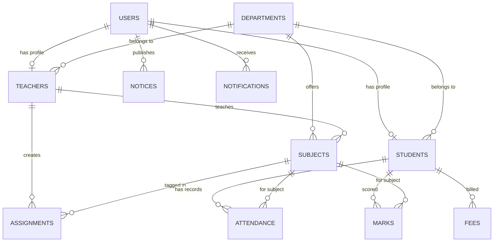

# Smart College ERP System

[](https://laravel.com)
[](https://react.dev)
[](https://vitejs.dev)
[](https://tailwindcss.com)
[](https://www.mysql.com)
[](#license)

A modern, production-ready, full-stack **College Enterprise Resource Planning (ERP)** web application built to streamline academic administration, coursework management, student records, attendance tracking, exam scoring, assignment workflows, fee monitoring, and campus-wide notice distribution.

The application features a decoupled architecture with a **Laravel 13 REST API** backend and a **React 19 + Vite** frontend, secured with **Laravel Sanctum** token-based authentication and role-based access controls (RBAC) tailored for **Admins**, **Teachers**, and **Students**.

---

## Table of Contents

- [Overview](#overview)
- [Key Features](#key-features)
  - [🛡️ Admin Portal](#️-admin-portal)
  - [👨‍🏫 Teacher Portal](#-teacher-portal)
  - [🎓 Student Portal](#-student-portal)
  - [⚡ Platform Capabilities](#-platform-capabilities)
- [Technology Stack](#technology-stack)
- [System Architecture](#system-architecture)
- [Database Schema & Data Models](#database-schema--data-models)
- [API Endpoints Reference](#api-endpoints-reference)
- [Project Directory Structure](#project-directory-structure)
- [Installation & Setup Guide](#installation--setup-guide)
  - [Prerequisites](#prerequisites)
  - [Backend Setup (Laravel API)](#backend-setup-laravel-api)
  - [Frontend Setup (React + Vite)](#frontend-setup-react--vite)
- [Demo Credentials](#demo-credentials)
- [Bulk Student CSV Import Specification](#bulk-student-csv-import-specification)
- [Verification & Testing](#verification--testing)
- [Future Enhancements](#future-enhancements)
- [Author & License](#author--license)

---

## Overview

Educational institutions require unified platforms to manage academic workflows, reduce administrative overhead, and maintain clear communications between faculties and students. The **Smart College ERP System** provides role-specific dashboards and intuitive workflows for everyday campus activities.

### Core Objectives
- **Centralized Data Management**: Eliminate fragmented record-keeping by consolidating departments, subjects, faculty profiles, and student rosters into a structured MySQL database.
- **Role-Based Workflows**: Deliver tailored UI views and strict API security guards for Administrators, Teachers, and Students.
- **Academic Tracking**: Simplify day-to-day attendance tracking, grade entries, assignment distribution, and fee monitoring.
- **Bulk Automation**: Enable administrators to onboard hundreds of students efficiently using CSV batch importing with row-level validation.

---

## Key Features

### 🛡️ Admin Portal
- **Dashboard Analytics**: High-level metrics showing total departments, faculty members, enrolled students, active subjects, recent campus announcements, and quick-action shortcuts.
- **Department Management**: Create, edit, list, and delete academic departments with custom course codes and descriptions.
- **Teacher Management**: Onboard faculty members, assign employee IDs, specify academic designations, and map them to their respective departments.
- **Student Management**: Full CRUD lifecycle for student profiles, enrollment numbers, semester tags, phone numbers, and department affiliations.
- **Bulk CSV Student Import**: Upload `.csv` or `.xlsx` files to batch-create student accounts with automated validation, row-by-row error reporting, and sample template downloads.
- **Subject Management**: Map subjects to specific departments, assign course faculty, set unit credit values, and maintain unique subject codes.
- **Global & Department Notices**: Draft and publish institution-wide or department-scoped announcements.

### 👨‍🏫 Teacher Portal
- **Faculty Dashboard**: Overview of assigned subjects, enrolled student count, pending coursework, and recent department activity.
- **Student Directory**: Access full student rosters filtered by department and subject enrollment.
- **Attendance Management**: Record, view, and update daily or subject-wise student attendance with statuses (**Present**, **Absent**, **Late**).
- **Marks & Exam Scoring**: Enter exam scores (midterms, finals, quizzes) against maximum marks, track student academic performance, and maintain grade logs.
- **Assignment Distribution**: Create assignments with detailed descriptions, deadlines, and subject tagging; automatically notifies enrolled students upon publication.
- **Class Notices**: Broadcast course and department-specific notices directly to student feeds.

### 🎓 Student Portal
- **Personalized Dashboard**: Visual summary of overall attendance percentage, upcoming assignment deadlines, fee payment status, and unread notifications.
- **Student Profile**: View personal credentials, enrollment number, current semester, assigned department, and contact information.
- **Attendance Tracker**: Subject-wise breakdown of attendance history, total conducted lectures, attended lectures, and real-time attendance percentage indicators.
- **Marks & Report Card**: View exam performance across all subjects with score breakdowns and total weightage.
- **Assignment Hub**: Track pending coursework, view instructions, check submission deadlines, and monitor completion status.
- **Fee Management**: Review fee status (**Paid**, **Pending**, **Overdue**), total amount due, and due dates.
- **Notice Board**: View campus announcements and department-specific updates.

### ⚡ Platform Capabilities
- **Token Authentication**: Secure authentication powered by Laravel Sanctum with automatic token state restoration in React.
- **In-App Notifications**: Automated notification engine triggering user alerts upon assignment creation, notice posting, or profile updates.
- **Enrollment Number Search**: Global quick-search bar allowing admins and teachers to look up student profiles by enrollment number instantly.
- **Toast Alert System**: Centralized UI notification system for user feedback on actions (success, error, warning).
- **Responsive Modern UI**: Modern dark-accented UI built with Tailwind CSS v4, Lucide icons, glassmorphic elements, and adaptive layouts for desktop, tablet, and mobile screens.

---

## Technology Stack

### Frontend
| Component | Technology | Description |
|---|---|---|
| **Framework** | [React 19](https://react.dev/) | Component-based UI library |
| **Build Tool** | [Vite 8](https://vitejs.dev/) | Fast frontend bundler and development server |
| **Styling** | [Tailwind CSS v4](https://tailwindcss.com/) | Utility-first CSS framework |
| **Routing** | [React Router v7](https://reactrouter.com/) | Client-side routing with protected route guards |
| **HTTP Client** | [Axios](https://axios-http.com/) | Promise-based HTTP client for API requests |
| **Icons** | [Lucide React](https://lucide.dev/) | Modern icon set |
| **Date Format** | [Day.js](https://day.js.org/) | Lightweight JavaScript date utility |

### Backend
| Component | Technology | Description |
|---|---|---|
| **Framework** | [Laravel 13](https://laravel.com/) | PHP web application framework |
| **Language** | PHP 8.3+ | Object-oriented server-side language |
| **Authentication**| [Laravel Sanctum](https://laravel.com/docs/sanctum) | Lightweight API token authentication |
| **ORM** | Eloquent ORM | Database object-relational mapping |
| **Testing** | PHPUnit 12 | Automated backend unit & feature testing |
| **Code Style** | Laravel Pint | Opinionated PHP code style fixer |

### Database
| Component | Technology | Description |
|---|---|---|
| **Database Engine** | [MySQL 8.0+](https://www.mysql.com/) | Relational database management system |

---

## System Architecture

```text
               ┌─────────────────────────────────────────┐
               │              React 19 SPA               │
               │   (Vite + Tailwind CSS + React Router)  │
               └────────────────────┬────────────────────┘
                                    │
                                    │ REST API (JSON)
                                    │ Bearer Token Auth
                                    ▼
               ┌─────────────────────────────────────────┐
               │           Laravel 13 REST API           │
               │   (Sanctum Auth + Middleware RBAC)      │
               └────────────────────┬────────────────────┘
                                    │
                                    │ Eloquent ORM
                                    ▼
               ┌─────────────────────────────────────────┐
               │              MySQL Database             │
               │ (Departments, Users, Students, Marks...) │
               └─────────────────────────────────────────┘
```

---

## Database Schema & Data Models

The system architecture uses relational mappings to connect users, academic roles, departments, subjects, and records:



### Table Definitions
- **`users`**: Core credentials (`id`, `name`, `email`, `password`, `role` enum: `admin`, `teacher`, `student`).
- **`departments`**: Academic units (`id`, `name`, `code`, `description`).
- **`teachers`**: Faculty records (`id`, `user_id`, `department_id`, `employee_id`, `designation`).
- **`students`**: Enrolled students (`id`, `user_id`, `department_id`, `enrollment_no`, `semester`, `phone`).
- **`subjects`**: Courses offered (`id`, `department_id`, `teacher_id`, `code`, `name`, `credits`).
- **`attendance`**: Daily log (`id`, `student_id`, `subject_id`, `date`, `status`: `present`, `absent`, `late`).
- **`marks`**: Examination scores (`id`, `student_id`, `subject_id`, `exam_name`, `marks_obtained`, `max_marks`).
- **`assignments`**: Course tasks (`id`, `teacher_id`, `subject_id`, `title`, `description`, `deadline`).
- **`fees`**: Tuition statements (`id`, `student_id`, `amount`, `status`: `paid`, `pending`, `overdue`, `due_date`).
- **`notices`**: Announcements (`id`, `title`, `content`, `created_by_user_id`, `is_global`, `department_id`).
- **`notifications`**: User alert logs (`id`, `user_id`, `title`, `message`, `is_read`, `data`).

---

## API Endpoints Reference

### 🔑 Authentication
| Method | Endpoint | Description | Access |
|---|---|---|---|
| `POST` | `/api/login` | Authenticate user & issue Sanctum bearer token | Public |
| `GET` | `/api/me` | Fetch active user session details | Authenticated |
| `POST` | `/api/logout` | Revoke active token & destroy session | Authenticated |

### 🔔 Shared & Notifications
| Method | Endpoint | Description | Access |
|---|---|---|---|
| `GET` | `/api/notifications` | Fetch user notification list | Authenticated |
| `POST` | `/api/notifications/read-all` | Mark all notifications as read | Authenticated |
| `GET` | `/api/students/search/{enrollmentNo}` | Quick lookup student details by enrollment number | Admin, Teacher |

### 🛡️ Admin Module (`/api/admin`)
| Method | Endpoint | Description | Access |
|---|---|---|---|
| `GET` | `/api/admin/dashboard` | Fetch administrative metrics & summary counts | Admin |
| `GET/POST` | `/api/admin/departments` | List or create departments | Admin |
| `PUT/DELETE`| `/api/admin/departments/{id}`| Update or delete department | Admin |
| `GET/POST` | `/api/admin/teachers` | List or register teacher profiles | Admin |
| `GET/PUT/DEL`| `/api/admin/teachers/{id}` | View, update, or remove teacher | Admin |
| `GET/POST` | `/api/admin/students` | List or enroll new student | Admin |
| `GET/PUT/DEL`| `/api/admin/students/{id}` | View, update, or delete student profile | Admin |
| `POST` | `/api/admin/students/import` | Upload CSV/Excel file for bulk student creation | Admin |
| `GET` | `/api/admin/students/sample` | Download sample CSV import template file | Admin |
| `GET/POST` | `/api/admin/subjects` | List or add academic subjects | Admin |
| `PUT/DELETE`| `/api/admin/subjects/{id}` | Modify or remove subject | Admin |
| `GET/POST` | `/api/admin/notices` | List or create global/department notices | Admin |
| `PUT/DELETE`| `/api/admin/notices/{id}` | Edit or delete notice | Admin |

### 👨‍🏫 Teacher Module (`/api/teacher`)
| Method | Endpoint | Description | Access |
|---|---|---|---|
| `GET` | `/api/teacher/dashboard` | Fetch teacher dashboard summary | Teacher |
| `GET` | `/api/teacher/subjects` | Fetch list of subjects taught by faculty | Teacher |
| `GET` | `/api/teacher/students` | Fetch students enrolled in teacher's subjects | Teacher |
| `GET/POST` | `/api/teacher/attendance` | Fetch or mark student attendance records | Teacher |
| `GET/POST` | `/api/teacher/marks` | Fetch or post exam scores for students | Teacher |
| `GET/POST` | `/api/teacher/assignments` | List or assign new coursework | Teacher |
| `PUT/DELETE`| `/api/teacher/assignments/{id}`| Edit or delete assignment | Teacher |
| `GET/POST` | `/api/teacher/notices` | List or post class announcements | Teacher |

### 🎓 Student Module (`/api/student`)
| Method | Endpoint | Description | Access |
|---|---|---|---|
| `GET` | `/api/student/dashboard` | Fetch student overview metrics | Student |
| `GET` | `/api/student/profile` | Fetch student personal profile details | Student |
| `GET` | `/api/student/attendance` | Fetch subject-wise attendance history & stats | Student |
| `GET` | `/api/student/marks` | View examination scores & report card | Student |
| `GET` | `/api/student/fees` | View fee statements, status & due dates | Student |
| `GET` | `/api/student/assignments` | View assigned coursework & deadlines | Student |
| `GET` | `/api/student/notices` | View campus announcements & department notices | Student |

---

## Project Directory Structure

```text
smart-college-erp/
├── backend/                        # Laravel 13 Backend Application
│   ├── app/
│   │   ├── Enums/                  # UserRole, FeeStatus, AttendanceStatus Enums
│   │   ├── Http/
│   │   │   ├── Controllers/Api/   # Auth, Admin, Teacher, Student API Controllers
│   │   │   └── Middleware/         # RoleMiddleware (RBAC Guard)
│   │   ├── Models/                 # User, Student, Teacher, Department, Subject, etc.
│   │   └── Services/               # StudentImportService (CSV Importer)
│   ├── config/                     # Application & Sanctum Configurations
│   ├── database/
│   │   ├── factories/              # Model Factories for Seeding
│   │   ├── migrations/             # Database Table Migrations
│   │   └── seeders/                # DatabaseSeeder with Default Accounts
│   ├── routes/
│   │   └── api.php                 # Central REST API Routing
│   ├── tests/                      # Automated Unit & Feature Tests
│   ├── composer.json               # Backend Dependencies
│   └── .env.example                # Backend Environment Template
│
├── frontend/                       # React 19 Frontend Application
│   ├── public/                     # Static Web Assets
│   ├── src/
│   │   ├── assets/                 # Icons, Images, CSS Assets
│   │   ├── components/
│   │   │   ├── auth/               # ProtectedRoute Component
│   │   │   ├── layout/             # Sidebar, Header, Navigation Components
│   │   │   └── ui/                 # Reusable UI Components (Modal, Table, Cards)
│   │   ├── context/                # AuthContext & AlertContext State Providers
│   │   ├── lib/                    # Helper Utilities & Constants
│   │   ├── pages/
│   │   │   ├── admin/              # Admin Section Pages (Students, Teachers, Depts)
│   │   │   ├── teacher/            # Teacher Section Pages (Attendance, Marks, Assignments)
│   │   │   ├── student/            # Student Section Pages (Profile, Marks, Fees)
│   │   │   ├── LoginPage.jsx       # Login Screen
│   │   │   └── NotFoundPage.jsx    # 404 Route Screen
│   │   ├── services/               # Axios API Client Instance & Interceptors
│   │   ├── App.jsx                 # Main Application Component & Router Configuration
│   │   └── main.jsx                # React App Entry Point
│   ├── package.json                # Frontend Dependencies
│   ├── vite.config.js              # Vite Build Configuration
│   └── .env.example                # Frontend Environment Template
│
└── README.md                       # Comprehensive Project Documentation
```

---

## Installation & Setup Guide

### Prerequisites
Ensure your local environment meets the following requirements:
- **Node.js**: `v18.0` or higher
- **npm**: `v9.0` or higher
- **PHP**: `v8.3` or higher with PDO, OpenSSL, Mbstring, and cURL extensions enabled
- **Composer**: `v2.5` or higher
- **MySQL Database**: `v8.0` or higher (or MariaDB equivalent)

---

### Backend Setup (Laravel API)

1. **Navigate to the backend directory**:
   ```bash
   cd backend
   ```

2. **Install PHP dependencies**:
   ```bash
   composer install
   ```

3. **Configure environment variables**:
   Create a `.env` file from `.env.example`:
   - **Windows (PowerShell)**:
     ```powershell
     copy .env.example .env
     ```
   - **Linux / macOS**:
     ```bash
     cp .env.example .env
     ```

4. **Set up MySQL Database**:
   Create a new database in MySQL:
   ```sql
   CREATE DATABASE smart_college_erp;
   ```

   Update the database connection settings in your `backend/.env` file:
   ```env
   DB_CONNECTION=mysql
   DB_HOST=127.0.0.1
   DB_PORT=3306
   DB_DATABASE=smart_college_erp
   DB_USERNAME=root
   DB_PASSWORD=your_password
   ```

5. **Generate Application Encryption Key**:
   ```bash
   php artisan key:generate
   ```

6. **Run Migrations & Seed Default Accounts**:
   ```bash
   php artisan migrate:fresh --seed
   ```

7. **Launch Backend Development Server**:
   ```bash
   php artisan serve
   ```
   *The Laravel API server will start at `http://127.0.0.1:8000`.*

---

### Frontend Setup (React + Vite)

1. **Open a new terminal window** and navigate to the frontend directory:
   ```bash
   cd frontend
   ```

2. **Install Node.js dependencies**:
   ```bash
   npm install
   ```

3. **Configure Environment File**:
   Create a `.env` file from `.env.example`:
   - **Windows (PowerShell)**:
     ```powershell
     copy .env.example .env
     ```
   - **Linux / macOS**:
     ```bash
     cp .env.example .env
     ```

   Ensure `.env` points to the Laravel API URL:
   ```env
   VITE_API_BASE_URL=http://127.0.0.1:8000/api
   ```

4. **Launch Vite Development Server**:
   ```bash
   npm run dev
   ```
   *The frontend client will start at `http://127.0.0.1:5173`.*

---

## Demo Credentials

The backend seeder populates default accounts for testing all three user roles.

| Role | Email Address | Default Password | Access Level |
|---|---|---|---|
| 🛡️ **Admin** | `admin@example.com` | `password` | Full Administrative Access |
| 👨‍🏫 **Teacher** | `teacher@example.com` | `password` | Faculty & Class Management |
| 🎓 **Student** | `student@example.com` | `password` | Personal Student Portal |

> ⚠️ *Note: These credentials are seeded strictly for development and testing environments. Change them prior to deploying to production.*

---

## Bulk Student CSV Import Specification

Administrators can batch import students via the **Student Management** page. The application accepts `.csv` and `.xlsx` files.

### Required Header Columns
Your CSV file must contain the following exact column headers:

```csv
name,email,enrollment_no,department_code,semester,phone
John Doe,john.doe@example.com,IT2026101,IT,4,9876543210
Jane Smith,jane.smith@example.com,CS2026102,CS,2,9876543211
```

### Import Validation Rules
- **`name`**: Required string (Max 255 chars).
- **`email`**: Required valid email format; must be unique in the system.
- **`enrollment_no`**: Required string; must be unique in the system.
- **`department_code`**: Required string; must match an existing department code (e.g., `IT`, `CS`).
- **`semester`**: Required integer between `1` and `8`.
- **`phone`**: Optional string.

The import engine reports successful creations alongside detailed row-by-row failure explanations for invalid rows. Administrators can also download a pre-formatted `students_sample.csv` directly from the upload modal interface.

---

## Verification & Testing

### Automated Backend Tests
Run PHPUnit test suites for authentication, middleware protection, and API endpoints:
```bash
cd backend
php artisan test
```

### Code Formatting
Ensure PHP code standards comply with Laravel Pint:
```bash
cd backend
vendor/bin/pint
```

### Production Build Verification
Verify that the React frontend compiles cleanly for production:
```bash
cd frontend
npm run build
```

---

## Future Enhancements

- 💳 **Online Fee Gateway Integration**: Stripe / Razorpay integration for online student tuition payments.
- 📄 **PDF Report Generation**: Export automated student report cards, attendance transcripts, and fee receipts to PDF.
- 📧 **Automated Email & SMS Notifications**: Send email alerts for overdue fees, exam schedules, and urgent notices.
- 📅 **Interactive Timetable & Calendar**: Visual schedule manager for faculty lectures and exam dates.
- 📊 **Advanced Analytics Dashboard**: Graphical insights on grade distribution, attendance trends, and departmental performance.

---

## Author & License

### Author
**Talha Shaikh**  
*Junior Web Developer*  
India

### License
This project is open-source and released under the [MIT License](LICENSE).
